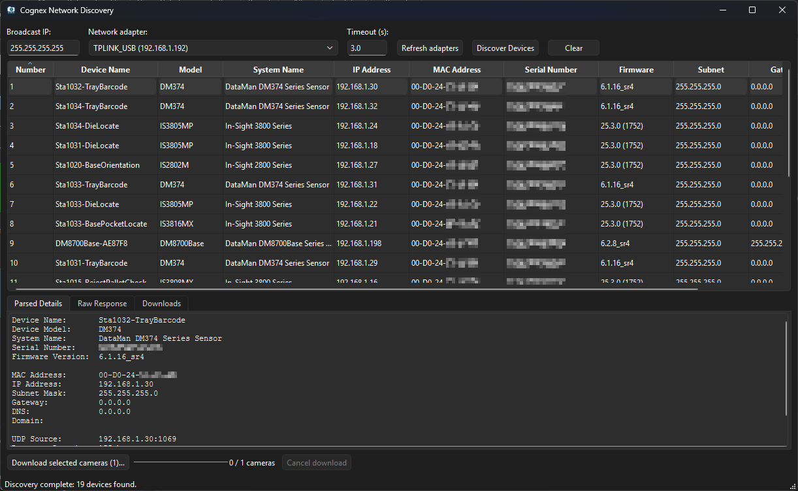
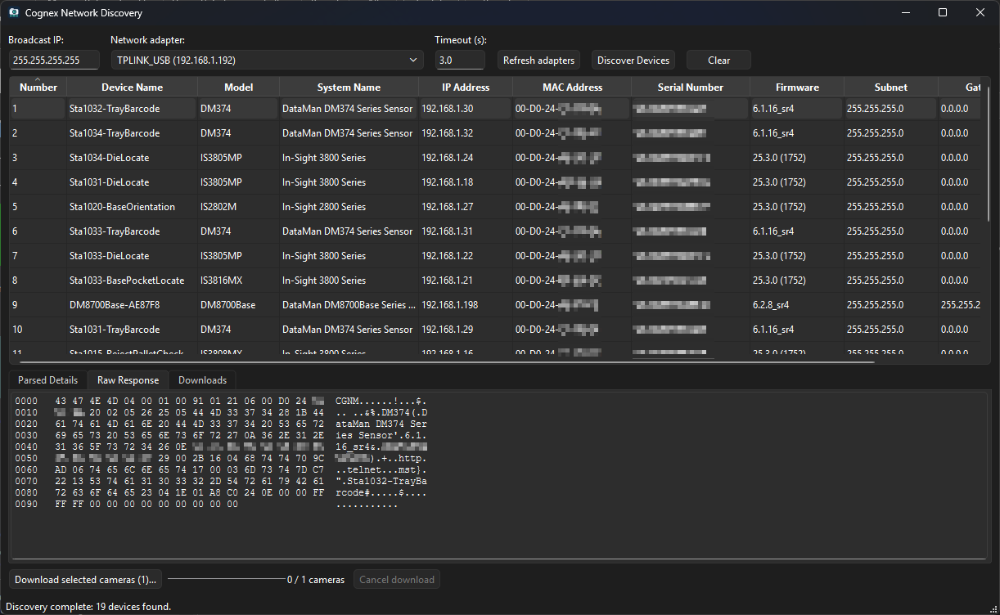
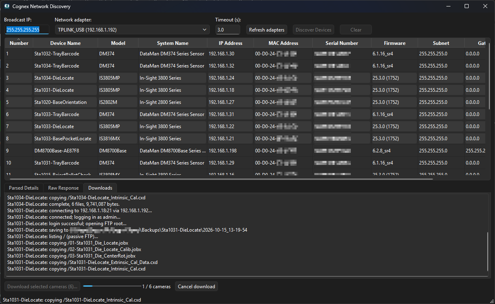

# Cognex Discovery

A small Python desktop application for discovering Cognex devices on a local
IPv4 network. It sends a UDP discovery request and displays device information
alongside the original response bytes.



## Features

- Discover devices using a configurable broadcast address and local interface.
- Select a network adapter by name and IPv4 address, and refresh the adapter list.
- Sort numbered device rows by clicking any column header.
- View device names, models, firmware, serial numbers, MAC and IP addresses.
- Inspect subnet, gateway, DNS, domain, and a hexadecimal packet dump.
- Keep the interface responsive while discovery runs in a background thread.
- Download the entire FTP root from selected cameras into Device Name folders.
- Use the discovery and parser functions independently of the GUI.

## Requirements

- Python 3.10 or newer.
- A graphical desktop to run the application.
- Network access to the devices and permission for UDP traffic on port 1069.

The application uses PySide6 for the desktop interface and psutil to enumerate
network adapters. Both are installed automatically by pip.

## Install and run

From a downloaded or cloned checkout:

```powershell
python -m venv .venv
.\.venv\Scripts\python.exe -m pip install .
.\.venv\Scripts\python.exe -m cognex_discovery
```

On macOS/Linux, use `.venv/bin/python` in place of
`.\.venv\Scripts\python.exe`. After activating the virtual environment, the
installed `cognex-discovery` command also opens the application.

## Usage

1. Leave **Broadcast IP** at `255.255.255.255`, or enter the broadcast address
   appropriate to your subnet.
2. Choose a **Network adapter** by name and IPv4 address, or leave **Automatic**
   selected for the OS-selected interface. Use **Refresh adapters** after network
   changes. Adapters with multiple IPv4 addresses have an entry for each address.
3. Choose a positive, finite **Timeout (s)** and click **Discover Devices**.
4. Select a result to inspect **Parsed Details** and **Raw Response**.
5. Click a column header to sort; click again to reverse the order. **Number**
   records the original discovery order and stays with its device when sorted.

Results appear when the scan finishes. Replies are deduplicated by MAC address,
falling back to IP address. **Clear** clears the displayed results; it does not
cancel an active scan.

The **Raw Response** tab shows the selected device's original discovery reply as
a hexadecimal and ASCII dump.



If no devices appear, check the selected adapter, subnet, device power, and
firewall rules. Broadcast discovery usually stays within the local broadcast
domain. VPNs and multiple network adapters can affect routing.

## Download camera files

1. Discover cameras, then use Ctrl-click or Shift-click to select camera rows.
2. Click **Download selected cameras** and choose a local destination folder.
3. Use **FTPS (explicit TLS, port 21)** for servers that require encryption. Certificate
   verification is disabled by default to support camera self-signed certificates.
   FTPS still encrypts the connection, but server identity is not verified.
   Enable **Verify server certificate** to validate the server certificate.
   Choose plain **FTP** only for cameras that require it.
4. Leave the username at `admin` and the password empty, or enter different
   credentials. Credentials apply to all cameras in this batch and are not saved.
5. Click **Download**. The **Downloads** tab shows the current file and each
   camera's result; the progress bar counts processed cameras, including failures.

The **Downloads** tab displays transfer activity while the selected cameras are
backed up.



Each camera is copied recursively from its FTP root (`/`), preserving its
subfolders and binary file contents. A folder named after **Device Name** is
created or reused in the destination. Each backup is saved inside it in a local-time
`YYYY-MM-DD_HH-MM-SS` subfolder, for example
`Line 1 Camera/2026-10-15_14-30-05/`. Characters invalid in Windows camera folder
names are replaced; unnamed cameras use their IP address. Backups made within the
same second get numbered suffixes such as `2026-10-15_14-30-05 (2)`, so earlier
backups are preserved. Cameras with identical Device Names share the parent
folder but always get separate backup subfolders.

Transfers run sequentially in the background. A camera failure is reported and
the next camera is attempted. **Cancel download** stops the batch; completed
files are kept and incomplete files are removed. Cancellation can wait for the
current network operation to time out (10 seconds). Closing during a download
requests cancellation; close again after it finishes.

FTP uses port 21 and passive transfers, bound to the selected network adapter
when one is specified. FTPS encrypts both login and data transfers and never
falls back to unencrypted FTP automatically. Plain FTP is unencrypted. The application only reads camera
files; it does not upload, delete, or configure anything on the camera. Directory
listing uses MLSD with an NLST/CWD fallback for older servers. Unsupported file
names, entry types, inaccessible paths, or directory loops are reported as a
camera failure; consult the log before treating a backup as complete. Real camera
FTP compatibility still needs verification on your hardware.

## Python API

```python
from cognex_discovery import discover_cognex_devices

devices = discover_cognex_devices(
    broadcast_ip="255.255.255.255",
    local_ip="",  # Or an IPv4 address assigned to the desired local adapter.
    timeout_seconds=3.0,
    status_callback=print,
)
for device in devices:
    print(device.device_name, device.ip_address, device.mac_address)
```

This function blocks for the scan and invokes callbacks in the calling thread.
Invalid settings raise `ValueError`; socket failures propagate as `OSError`.
`parse_cognex_response(data, source_ip="", source_port=0)` parses saved bytes
without network access. Importing the package does not import PySide6.

## Protocol scope and limitations

The tool retains the original script's inferred protocol: one request containing
`43 47 4E 4D 04 00 02 00 00` is sent to UDP port 1069. Responses are searched
for the `CGNM` identifier and known length-prefixed field markers. Network
addresses in those fields are interpreted as little-endian values.

Parsing is best effort, not a complete protocol implementation. Marker bytes
inside other values can be mistaken for fields, and field order or layout may
vary by device or firmware. Missing fields remain empty; an absent IP field
falls back to the UDP source address. Raw bytes remain available for inspection.
Hardware compatibility has not been established by the automated tests, which
use synthetic packets and mocked sockets. No device configuration is changed.

This is an independent utility and is not an official Cognex SDK.

## Build a Windows executable

Run these commands on Windows from the repository root (Python 3.10 or newer):

```powershell
python -m venv .venv
.\.venv\Scripts\python.exe -m pip install -e ".[build]"
.\tools\release\build.ps1
```

The release artifact is `dist/CognexDiscovery-v<version>-windows-<arch>.zip`
(for example, `CognexDiscovery-v0.3.2-windows-x64.zip`), ready to upload to a GitHub
Release. The ZIP contains a versioned folder with `CognexDiscovery.exe` and this
README. Extract it and run the executable; Python is not required on the target
computer. The executable has no console window and retains the application icon.
Version comes from `pyproject.toml`; architecture comes from the built executable.

The unpackaged executable stays in `build/executable/`. Every executable build
also packages the ZIP, replacing only the archive for that version and architecture.
Older release archives are kept. Python wheel/source package builds remain separate
(`python -m build`); upload the Windows ZIP as the desktop release asset.
The build script stops on errors and can be run from any working directory.
To use a different virtual environment:

```powershell
.\tools\release\build.ps1 -Python C:\path\to\venv\Scripts\python.exe
```

The window and executable both use
`src/cognex_discovery/assets/cognex-discovery.ico`. The icon is included in Python
packages and in the executable so it also works after installation. Its editable
SVG source is beside it. After editing the SVG, regenerate the ICO before building:

```powershell
.\.venv\Scripts\python.exe tools/generate_icon.py
```

This generates seven icon sizes from 16 to 256 pixels. The PyInstaller spec and
launcher are in `tools/release/`; intermediate build files stay under `build/`.

## Development

```console
python -m pip install -e ".[dev]"
python -m unittest discover -s tests -v
python -m ruff check .
python -m ruff format --check .
python -m build
```

GitHub Actions runs linting, formatting, tests, and package builds on Windows
and Linux with Python 3.10 and 3.14.

```text
src/cognex_discovery/
    discovery.py     Data model, packet parsing, and UDP discovery
    app.py           PySide6 interface and main-thread event handling
    interfaces.py    Network-adapter enumeration
    ftp_download.py  Recursive FTP copying and local folder handling
    __main__.py      Module launcher
tests/              Parser, socket, FTP, and GUI regression tests
pyproject.toml      Package metadata and development tools
```

A license has not yet been selected; no open-source license grant is included.
